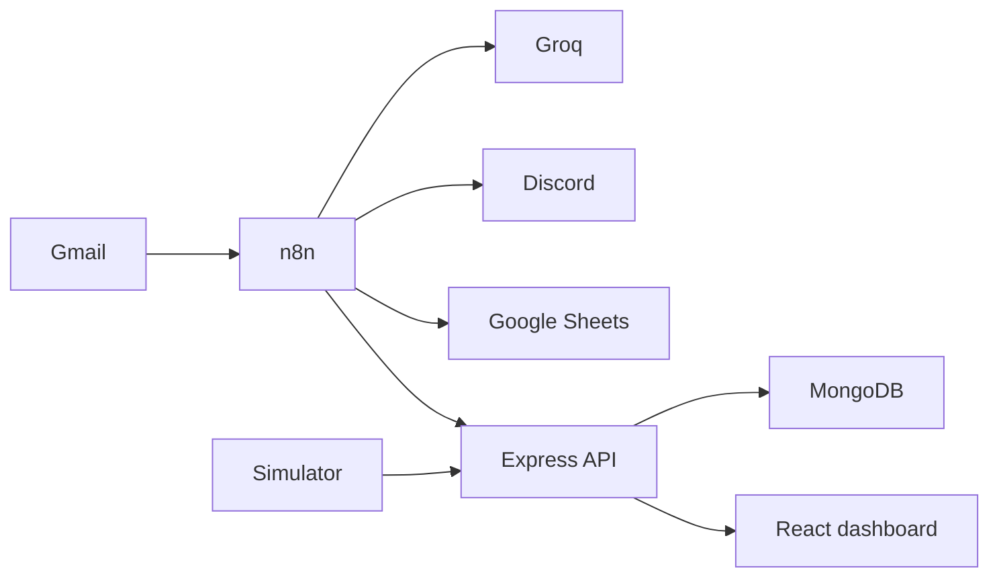

# Smart-Inbox


Smart Inbox is an email-triage dashboard with a Node/Express API, MongoDB storage and an optional n8n automation. It classifies messages as Urgent, Lead, Support, Newsletter or Other using Groq when configured, with a keyword fallback when the model is unavailable.

## Live demo video

https://github.com/user-attachments/assets/c9ac15b5-fda7-4c13-ac75-2968706ebe76

[Download video](docs/media/smart-inbox-demo.mp4) · [HTML presentation source](docs/media/smart-inbox-demo.html)

[Open Smart Inbox](https://smart-inbox-six.vercel.app/). The presentation uses illustrative email/account data and simulated workflow states; it does not prove real delivery latency or mailbox access.

## Architecture



| Path | Purpose |
| --- | --- |
| backend/ | JWT accounts, settings, classification, ingestion, Gmail OAuth and n8n provisioning |
| frontend/ | React/Vite dashboard, simulation and settings |
| n8n/ | Importable automation workflow and deployment notes |
| docker-compose.yml, render.yaml | Deployment examples requiring environment review |

## Run locally

Use Node.js 22 and a local/disposable MongoDB database. The dashboard's simulator can run without connecting Gmail or n8n.

```sh
npm ci --prefix backend
npm ci --prefix frontend
cp backend/.env.example backend/.env
# Configure a local database and independent JWT/CRED secrets.
cd backend
npm run dev
# In a separate terminal, from frontend/:
npm run dev
```

API: http://localhost:4000. Frontend: http://localhost:5173. Vite proxies /api during development. Seeding is optional and creates a known demonstration account; run npm run seed only against a disposable development database. Never put private email in the public demo account.

For real mail, follow [n8n setup](n8n/README.md) and configure your own Gmail OAuth app, n8n API credentials, routing destinations and scopes. Connecting services can send messages or create workflows; CI does none of those operations.

## Verification and limits

CI builds the frontend and runs isolated classification/encryption tests. Synthetic tests cover keyword routing, model fallback and authenticated-encryption tamper detection; they do not validate MongoDB isolation, OAuth permissions, real n8n delivery, external-service uptime or production security.

The legacy ingestion fallback and development secret defaults need review before handling private mail. See [security](SECURITY.md), [configuration](docs/configuration.md) and [testing](docs/testing.md).

## Maintenance status

See [verification](docs/verification.md) for checks actually run and [dependency health](docs/dependency-health.md) for remaining findings.

## Contributing and maintenance

[Contributing](CONTRIBUTING.md) · [Support](SUPPORT.md) · [Security](SECURITY.md) · [Code of conduct](CODE_OF_CONDUCT.md) · [Changelog](CHANGELOG.md)

## License

[MIT](LICENSE) for original contributions the maintainer is authorized to license. Third-party and collaborator rights remain separate; see [license scope](docs/license-scope.md).
